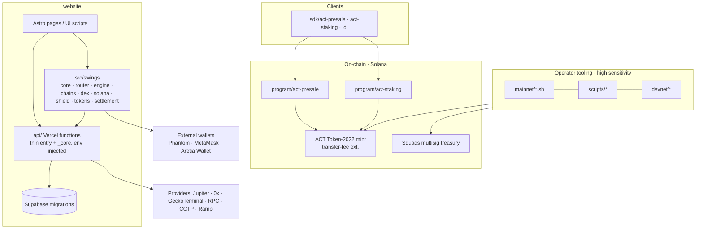

# Aretia Finance — Target Architecture, Migration Map & Plan (Stage A proposal)

Date: 2026-10-11 · Companion to [`BASELINE.md`](BASELINE.md) · Status: **proposal. Nothing here is implemented. No files have been moved.**

## 1. Verdict

This repository is a protocol workspace, not a single application. The brief's monorepo template (`apps/`, `packages/domain`, …) does **not** fit it and would mostly create empty packages. The highest-value, lowest-risk path is:

1. Give each existing project the same verification contract (install, test, lint, build, audit, secret scan) in CI.
2. Make the on-chain programs and operator tooling reviewable and reproducible — they are currently the least verified and most funds-sensitive code (F-02, F-03, F-04).
3. Enforce the layering that `website/src/swings` already intends, and fix the one proven inversion (F-05).
4. Document module ownership, trust boundaries and an audit pack for the on-chain side, to match what already exists for Swings.

No directory moves are proposed for the on-chain projects: Anchor workspaces must stay self-contained and their paths appear in `Anchor.toml`, docs and scripts.

## 2. Target module map (existing code, grouped by responsibility)



Intended dependency direction inside `website/src`: `swings/core` and `swings/*` (pure logic, no DOM, no `scripts/`) ← `scripts/*` (UI glue) ← `pages/*`. Today, `swings/core/{fee,feeAssets,token}`, `shield/classify`, `settlement/cctp*` import `scripts/walletTools` (F-05); that edge is reversed in Stage C. Five `swings` files reference `window`/`document` (`chains/evmWallet`, `engine/price`, `wallet/{solanaContextWallet,types,walletConnect}`); these are the wallet-adapter edge and are acceptable if isolated and listed, but must be confirmed individually.

Trust boundaries to document in Stage D: browser ↔ user's wallet (signing) · browser ↔ Vercel API (no provider keys in client) · Vercel ↔ Supabase (service-role key, server-only) · cron secret · operator workstation ↔ mainnet (deployer keypair, Squads signers) · third-party providers/aggregators (untrusted data).

## 3. Proposed directory delta

```
Aretia-Finance/
├── .github/
│   ├── workflows/
│   │   ├── website-ci.yml     # keep; SHA-pin actions; blocking audit threshold
│   │   ├── programs-ci.yml    # NEW: pinned toolchain, cargo build/test/clippy/audit
│   │   ├── sdk-scripts-ci.yml # NEW: install/typecheck/audit for sdk + scripts
│   │   └── (codeql, swings-discover unchanged)
│   ├── CODEOWNERS  dependabot.yml  pull_request_template.md   # NEW
├── docs/
│   ├── architecture/   # BASELINE.md, PROPOSAL.md, OVERVIEW.md, MIGRATION_LOG.md
│   ├── adr/            # NEW
│   ├── audit/          # NEW: on-chain audit pack (scope, privileged ops, controls, findings, remediation, evidence, releases)
│   └── security/       # NEW: key management & operator runbook, treasury/multisig model
├── CONTRIBUTING.md  SECURITY.md  .nvmrc  rust-toolchain.toml   # NEW
└── (program/, sdk/, scripts/, mainnet/, devnet/, website/ unchanged)
```

`website/docs/audit` and `website/docs/aretia-swings` stay where they are (they scope Swings); the new root `docs/audit` covers the on-chain side and links to them rather than duplicating.

## 4. File migration map

| From | To | Stage | Risk / gate |
|---|---|---|---|
| — | `docs/*`, governance files | B | None |
| `program/*/Cargo.lock` (git-ignored) | tracked | B | Remove 1 line from `.gitignore`; commit lockfiles generated by a pinned toolchain. Does not change program source |
| `SWAP_FEE_WALLET`, `KNOWN_TOKENS`, `isSolanaAddress`, `ataAddress`, `TOKEN_PROGRAM_ID` in `src/scripts/walletTools.ts` | `src/swings/core/config.ts` (new), with `walletTools.ts` re-exporting the same names | C | **Fee-destination-sensitive.** Precondition: a test asserting current values/behaviour; values must be byte-identical; separate PR; owner review |
| `solana/meteoraDbc.ts ↔ poolHints.ts` cycle | extract shared type/helper | C | Low |
| Logic in `src/scripts/walletSwings.ts` (2,108 lines) and `walletApp.ts` | into `src/swings/*` use-case modules | later / backlog | Medium; only with test coverage per extracted piece; not part of this effort's first pass |

## 5. Gates to add (Stage B, minimal and reversible)

- **Install integrity:** regenerate `website/package-lock.json` using CI's Node/npm and prove `npm ci` passes (F-01). Lockfile-only change, no dependency version changes.
- **CI:** SHA-pin actions; `permissions` least-privilege per job (already good); make `npm audit --omit=dev --audit-level=high` blocking with a dated allow-list for known issues (current: 3 moderate, so a `high` threshold passes today); add `programs-ci.yml` and `sdk-scripts-ci.yml`; extend gitleaks to a pre-merge check on all paths.
- **Boundary rule:** ESLint `no-restricted-imports` (already a dependency) forbidding `src/swings/**` → `src/scripts/**` and `src/pages/**`, introduced in *report-only* mode, with the five known violations in an explicit, dated exceptions list that shrinks as F-05 is fixed.
- **Programs:** add `rust-toolchain.toml`, track `Cargo.lock`, `cargo build-sbf` + `cargo clippy` + `cargo audit` in CI. First Rust/LiteSVM tests encode invariants already documented in PRESALE_DESIGN.md / STAKING_DESIGN.md (e.g. no early unlock, refund paths, authority checks) — **written against the existing code, without modifying it**. If a test exposes a defect it becomes a finding, not a silent fix.
- **Config:** `website/.env.example` already exists with placeholders; add a startup/readiness validation reference to `docs` (the repo already has `npm run readiness` — to be reviewed, not assumed sufficient).

## 6. Prioritised plan

| # | Stage | Task | Acceptance |
|---|---|---|---|
| 1 | B | Fix lockfile (F-01) | `npm ci` exits 0 with CI's npm |
| 2 | B | Governance files; CODEOWNERS for `program/`, `sdk/`, `mainnet/`, `scripts/`, `website/api`, `website/src/swings/{core,router,engine,wallet,shield}`, `.github/` | Files exist |
| 3 | B | Track `Cargo.lock`, toolchain pin, programs CI | CI green or failures recorded as findings |
| 4 | B | Operator-tooling review: inventory of every script that touches keys/mainnet, with required confirmations and who may run it (F-04) | `docs/security/OPERATOR_RUNBOOK.md` + findings |
| 5 | B | Lint boundary rule (report-only) | Violations listed |
| 6 | D | On-chain audit pack: scope, privileged operations, upgrade authority, mint/freeze/fee authority state, deployed-vs-source verification record | `docs/audit/*`, with "unverified" where applicable |
| 7 | C | Pin fee behaviour with tests; relocate constants (F-05) | Tests identical before/after; diff reviewed |
| 8 | D | Triage 3 moderate advisories (`jayson`/`stream-json`) | Reachability recorded |
| 9 | ADR | Website ↔ extension duplication (F-06) | Decision recorded; no code change |

## 7. Risk register (initial)

| ID | Risk | Likelihood | Impact | Basis | Mitigation |
|---|---|---|---|---|---|
| R-01 | Unaudited, untested presale/staking programs ship to mainnet | Medium | Critical | F-02; no Rust tests; no external audit referenced | Tests + external audit before any mainnet deploy; no deploy is performed by this work |
| R-02 | Non-reproducible program build → deployed bytecode can't be matched to source | High | High | F-03 | Track lockfile, pin toolchain, verifiable build, record hash per deploy |
| R-03 | Operator key handling error (mint/treasury authority) | Low–Medium | Critical | F-04 | Runbook, multisig-only authorities (Squads), dry-run flags, no keys on dev machines — confirm actual state |
| R-04 | Swap-fee destination or fee maths changed by an unrelated edit to a UI helper | Low | High | F-05 | Pinning test; relocate behind compatibility re-export |
| R-05 | Provider data (token metadata, quotes) manipulates user flows | Medium | High | Swings threat model already exists | Existing `judgeSwapSimulation`/Shield; re-review in Stage D |
| R-06 | Production cron secret/endpoint abuse | Low | Medium | `swings-discover.yml` | Secret rotation procedure documented |
| R-07 | Docs overstate readiness | Medium | High | F-10 | Add "implemented / designed only" status to each protocol doc |

## 8. Approval needed

Stage B items are documentation, CI and governance only. I intend to proceed with those after your confirmation of this plan. I will **not**, without explicit approval: change program source, regenerate or change dependency versions beyond the single lockfile fix, run any `mainnet/` or `scripts/` operator tool, touch fee/treasury configuration, or deploy anything.
